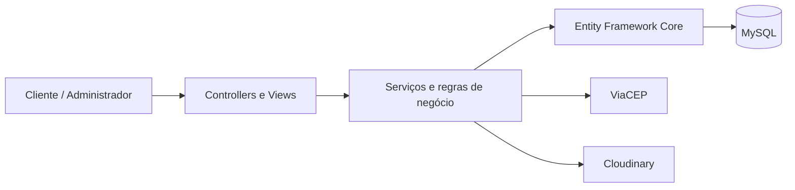

<div align="center">

# Kiora · experiência digital para restaurantes

**Um projeto de TCC que conecta gastronomia, delivery e gestão.**

`C#` · `ASP.NET Core MVC` · `.NET 10` · `MySQL` · `Entity Framework Core`

[**Explorar o site ↗**](https://kiorarestaurante.onrender.com) · [Portfólio Jujuba’s Dev](https://ghostriley115.github.io/Jujubas-LandindPage/)

</div>

## A ideia

O Kiora é um restaurante fictício criado para um Trabalho de Conclusão de Curso em Desenvolvimento de Sistemas. A proposta é construir uma experiência que começa no cardápio online e evolui para a operação do restaurante, aproximando clientes e funcionários por meio da tecnologia.

Este repositório reúne o **sistema web de delivery**, com navegação pelo cardápio, carrinho, pedidos e área administrativa. O aplicativo mobile faz parte da visão de evolução do projeto e **ainda não está implementado neste repositório**.

## Da escolha ao pedido

| Para quem pede | Para quem administra |
| :--- | :--- |
| Cardápio com categorias e produtos | Cadastro e edição de produtos |
| Carrinho com inclusão, alteração e remoção de itens | Controle de disponibilidade e ativação de produtos |
| Cadastro, login e edição de perfil | Painel e consulta de pedidos |
| Endereços de entrega e consulta de CEP | Consulta de usuários e alteração de situação |
| Checkout, detalhes e histórico de pedidos | Acesso restrito ao perfil de administrador |

A implementação também inclui carrinho associado a cookies, mesclagem de carrinho, limpeza de carrinhos e integração com Cloudinary para imagens de produtos. O registro de formas e estados de pagamento faz parte do domínio; isso **não representa uma integração com um gateway de pagamentos**.

## Identidade do restaurante

<table>
<tr>
<td width="50%"></td>
<td width="50%"></td>
</tr>
</table>

*Materiais ilustrativos da identidade do restaurante. Não são capturas da interface do sistema.*

## Como o sistema está organizado



| Camada | Responsabilidade |
| :--- | :--- |
| `Controllers` e `Views` | Fluxos HTTP e interface MVC |
| `Services` e interfaces | Operações e regras da aplicação |
| `Models`, DTOs e ViewModels | Entidades e contratos de dados |
| `Migrations` | Evolução do esquema do banco |
| `wwwroot` | Estilos, scripts e identidade visual |

A autenticação usa cookies e autorização por perfil. O projeto utiliza proteção antifalsificação nas operações configuradas e integração de consulta de endereços com ViaCEP.

## Visão de evolução

O objetivo futuro é conectar o delivery à experiência presencial do restaurante.

| Etapa | Situação neste repositório |
| :--- | :--- |
| Sistema web de delivery e área administrativa | Implementado, em evolução |
| Aplicativo mobile para a equipe | Planejado · não implementado |
| Reservas pelo aplicativo | Planejado · não implementado |
| Criação de pedidos no atendimento presencial | Planejado · não implementado |
| Gerenciamento de mesas pelos funcionários | Planejado · não implementado |
| Integração entre operação mobile e sistema web | Planejada · arquitetura a definir |

As funcionalidades planejadas descrevem a direção do TCC, sem representar recursos já disponíveis ou um cronograma de entrega.

## Executar localmente

**Pré-requisitos:** SDK .NET 10, instância MySQL acessível e credenciais próprias do Cloudinary para os fluxos de upload de imagens.

```bash
git clone https://github.com/GhostRiley115/KioraRestaurante.git
cd KioraRestaurante/KioraRestaurante
dotnet restore
dotnet user-secrets set "ConnectionStrings:ConexaoNuvem" "Server=localhost;Database=kiora;User=SEU_USUARIO;Password=SUA_SENHA;"
dotnet user-secrets set "Cloudinary:CloudName" "SEU_CLOUD_NAME"
dotnet user-secrets set "Cloudinary:ApiKey" "SUA_API_KEY"
dotnet user-secrets set "Cloudinary:ApiSecret" "SEU_API_SECRET"
```

Com a ferramenta `dotnet-ef` da série 9 instalada, aplique as migrations e inicie o projeto em desenvolvimento:

```bash
dotnet ef database update -- --environment Development
dotnet run -- --environment Development
```

Abra o endereço exibido no terminal. A conexão MySQL precisa funcionar já na inicialização, pois a aplicação detecta a versão do servidor. A configuração `Entrega:MunicipiosIbge` define os municípios atendidos e deve corresponder ao cenário de teste. Use dados fictícios para explorar os fluxos.

## Testes e atualização de sessões

Na raiz do repositório, execute `dotnet test KioraRestaurante.slnx`. Os testes de sessão usam SQLite em memória, cookies protegidos e usuários fictícios; não acessam o Aiven.

Antes de executar esta versão com um banco existente, aplique a migration `AdicionarVersaoSessaoUsuario` pelo procedimento acima, usando a conexão do ambiente desejado. Ela acrescenta uma versão de sessão às contas existentes. Os usuários precisarão entrar novamente após a atualização, pois cookies anteriores não possuem essa versão.

Ao trocar a senha, apenas a sessão que fez a alteração permanece aberta. As outras são recusadas na próxima requisição. Redefinir a senha ou desativar a conta também invalida sessões anteriores.

O login permite **5 tentativas por e-mail a cada minuto**, incluindo tentativas bem-sucedidas. Variações de e-mail reconhecidas pelo banco contam para a mesma conta, e `/Conta/Login` e `/Account/Login` compartilham a mesma proteção. Ao atingir o limite, a resposta é HTTP 429 com uma mensagem de espera e o cabeçalho `Retry-After`.

O limite é mantido na memória de cada instância e reinicia junto com a aplicação. Há um limite adicional opcional de **20 tentativas por IP por minuto**, ativado com `Seguranca__LimitarLoginPorIp=true`. Em hospedagens com proxy, como o Render, só o habilite após configurar a identificação confiável do IP de origem: sem isso, usuários diferentes podem compartilhar o IP do proxy e o mesmo limite. O aplicativo não confia diretamente no `X-Forwarded-For` enviado pelo cliente. Veja a [orientação oficial do ASP.NET Core sobre proxies confiáveis](https://learn.microsoft.com/aspnet/core/host-and-deploy/proxy-load-balancer?view=aspnetcore-10.0).

## Carrinho, combos e navegação

O carrinho e o checkout exibem a composição por unidade do combo. Os detalhes do cliente e do administrador usam a composição gravada no item do pedido, preservando o histórico mesmo após alterações no catálogo. Pedidos antigos sem composição registrada continuam sendo exibidos sem inventar componentes.

As respostas de carrinho incluem `versao`. Para alterar uma quantidade, remover um item ou esvaziar o carrinho, envie `versaoEsperada` no corpo JSON da requisição. Uma versão antiga recebe HTTP 409 com `codigo: "carrinho_desatualizado"`. A interface recarrega o carrinho e avisa o cliente, sem repetir automaticamente a alteração. A adição pelo cardápio continua somando unidades no servidor.

O login retoma somente destinos locais validados. Ao entrar pelo checkout, a reunião dos carrinhos visitante/conta termina antes de uma nova revisão do pedido. Depois de desativar a conta, a interface volta à Home com a sessão encerrada; o botão impede envios repetidos e permite tentar novamente se houver erro.

Além de `dotnet test KioraRestaurante.slnx`, os testes dos scripts podem ser executados com Node.js, sem instalar pacotes:

```bash
node --test KioraRestaurante.Tests/JavaScript/interface.test.cjs
```

## Recuperação de senha por e-mail

O fluxo tem três etapas: informar o e-mail, conferir o código recebido e escolher a nova senha. O servidor confere novamente o código junto com a conta ao redefinir a senha. Os códigos têm seis dígitos, são gerados com aleatoriedade criptográfica, armazenados com salt e hash no campo já existente e expiram após dez minutos. Um novo envio substitui o anterior. Redefinir a senha consome o código e revoga as sessões anteriores.

Por conta e por instância da aplicação, são permitidos três pedidos de envio a cada dez minutos e dez tentativas compartilhadas entre validar o código e redefinir a senha no mesmo intervalo. As rotas `Conta` e `Account` usam a mesma proteção. A resposta HTTP 429 inclui `Retry-After`. Os limites ficam em memória e reiniciam com a aplicação; uma futura hospedagem com várias instâncias precisará de contadores compartilhados. O limite opcional por IP segue `Seguranca:LimitarLoginPorIp` e as mesmas exigências de proxy confiável descritas acima.

O envio usa a Brevo e sempre recebe o endereço armazenado na conta. Configure `Brevo:ApiKey`, `Brevo:RemetenteEmail` e `Brevo:RemetenteNome` nos **User Secrets do Rider**. No Render, use as variáveis `Brevo__ApiKey`, `Brevo__RemetenteEmail` e `Brevo__RemetenteNome`. O remetente precisa estar autorizado na conta Brevo. O valor de exemplo do repositório não envia mensagens; não substitua esse exemplo por uma chave real em arquivos versionados.

Falhas de configuração, conexão ou recusa do provedor são registradas no servidor sem expor credenciais, código ou destinatário. O código cujo envio falhou é cancelado. A resposta pública permanece genérica para não revelar quais contas existem; por isso, ausência de e-mail deve ser investigada nos logs da aplicação e na configuração do provedor.

Esta integração não exige uma nova migration. Códigos de recuperação emitidos pelo mecanismo anterior devem ser solicitados novamente. Os testes usam SQLite em memória e transporte de e-mail simulado, sem enviar mensagens reais nem consultar o Aiven.

## Contexto

Projeto acadêmico apresentado no ecossistema **Jujuba’s Dev**. Kiora é uma marca fictícia; sua presença visual foi criada para dar contexto à solução de software.

[**Conheça os outros projetos de Clayton Brito →**](https://github.com/GhostRiley115)
